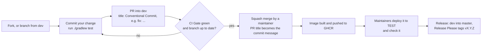

# Contributing to Digital Assistant Server

First off, thank you for considering contributing to the Digital Assistant Server! It's people like you that make this such a great project.

Following these guidelines helps to communicate that you respect the time of the developers managing and developing this open source project. In return, they should reciprocate that respect in addressing your issue or assessing patches and features.

## Getting Started

1.  **Fork the repository:** Start by forking the [main repository](https://github.com/Digital-Assistant/Digital-Assistant-Server) to your own GitHub account.
2.  **Clone your fork:** Clone your forked repository to your local machine:
    ```bash
    git clone https://github.com/YOUR_USERNAME/Digital-Assistant-Server.git
    ```
3.  **Navigate to the project directory:**
    ```bash
    cd Digital-Assistant-Server
    ```

## Development Workflow

1.  **Create a new branch:** Create a new branch for your feature or bug fix. Use a descriptive name, including the issue number if applicable.
    ```bash
    git checkout -b feature/your-feature-name
    ```
    or
    ```bash
    git checkout -b bugfix/issue-description
    ```
2.  **Make your changes:** Make your changes to the codebase.
3.  **Run tests:** Ensure that all tests pass before submitting a pull request.
    ```bash
    ./gradlew test
    ```
4.  **Lint and format:** Make sure your code adheres to the project's coding standards.
    ```bash
    ./gradlew formatCheck   # read-only: changed files must be formatted (Spotless, ratchet against origin/dev)
    ./gradlew format        # rewrites the changed Java files in place
    ./gradlew lint          # read-only: PMD bug-oriented ruleset
    ./gradlew typecheck     # compiles main and test code
    ./gradlew check         # the pre-merge gate: formatCheck, typecheck, test (needs the local stack), PMD
    ```
    The formatter only touches files you changed, so the rest of the tree stays as it is. Run `git fetch origin`
    first so `origin/dev` is current.

## Pull Request Process

How a change travels from your branch to a release:


1.  **Create a pull request:** Once your changes are ready, push your branch to your fork and create a pull request to the `dev` branch of the original repository. The PR title must follow [Conventional Commits](https://www.conventionalcommits.org/) (for example `fix: handle a missing session id`), because it becomes the commit message and drives the changelog.
2.  **Write a good description:** Provide a clear and concise description of your changes in the pull request. Explain the "what" and "why" of your contribution.
3.  **Tag reviewers:** Tag the appropriate reviewers for your pull request.
4.  **Address feedback:** Be responsive to any feedback or questions from the reviewers.

## Definition of Done

A pull request is considered "done" when it meets the following criteria:

*   All tests pass.
*   The code is well-documented.
*   The pull request has been reviewed and approved by at least one other contributor.
*   All feedback has been addressed.
*   The pull request is merged into the `dev` branch.
