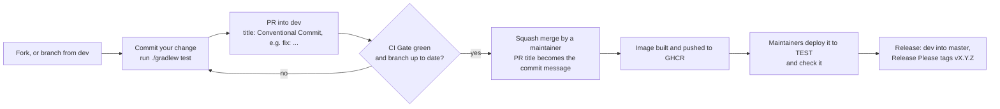

# Contributing to Digital Assistant Server

First off, thank you for considering contributing to the Digital Assistant Server! It's people like you that make this such a great project.

Following these guidelines helps to communicate that you respect the time of the developers managing and developing this open source project. In return, they should reciprocate that respect in addressing your issue or assessing patches and features.

## Getting Started

1.  **Fork the repository:** Start by forking the [main repository](https://github.com/Digital-Assistant/Digital-Assistant-Server) to your own GitHub account.
2.  **Clone your fork:** Clone your forked repository to your local machine:
    ```bash
    git clone https://github.com/YOUR_USERNAME/Digital-Assistant-Server.git
    ```
3.  **Navigate to the project directory:**
    ```bash
    cd Digital-Assistant-Server
    ```

4. **Set up the build:** follow [Setup (non-interactive)](README.md#setup-non-interactive) in the README. It
   holds the one setup command, so it is not repeated here.

## Commands

Gradle is the one runner. Run every command from the repository root. Gradle task names cannot contain `:`, so the
verb `format:check` is spelled `formatCheck`.

```bash
./gradlew build         # compiles, packages and runs check, tests included (needs the local stack)
./gradlew format        # rewrites the changed Java files in place
./gradlew formatCheck   # read-only: changed files must be formatted, and no baseline count may go up
./gradlew lint          # read-only: PMD bug-oriented ruleset
./gradlew typecheck     # compiles main and test code
./gradlew test          # runs all tests (needs the local stack)
./gradlew coverage      # runs the tests, then fails below the coverage floor (needs the local stack)
./gradlew check         # the pre-merge gate: formatCheck, typecheck, test, PMD (needs the local stack)
./gradlew security      # scans gradle.lockfile for known vulnerable dependencies (needs the network)
```

* **The local stack** is MariaDB and Elasticsearch on `127.0.0.1`, started from `udan-workspace` (`./udan up infra`,
  see `README.md`) or your own. Without it, run `./gradlew formatCheck typecheck lint`: the gate minus the tests.
* **Format:** Spotless follows `CONVENTIONS.md` (tabs, LF, 120 columns) and only touches files you changed. Run
  `git fetch origin` first, so the formatter compares against a current `origin/dev`.
* **Coverage:** the report goes to `build/reports/jacoco/test/`. `check` does not run the coverage floor; CI runs it
  in its `Coverage floor` step (`scripts/ci/coverage.sh`).
* **Security:** OSV-Scanner runs through `scripts/ci/scan.sh`. It is report-only: it prints the finding count and
  exits 0, because the existing findings are recorded debt. `SCAN_MODE=block` makes it fail.
  `./gradlew dependencyCheckAnalyze` is the old OWASP scan, not this verb; it needs an NVD key that is not set up.
* **Lint:** files that violated PMD when it was added are listed in the exclude patterns of
  `config/pmd/ruleset.xml`. That list only shrinks; new files are checked in full.
* **Dependencies:** add a new third-party library or dependency only when the task needs it. After you change a
  dependency or a plugin, regenerate the lock with `./gradlew dependencies --write-locks`.

### Running tests

`./gradlew test` runs all tests. The tests have no known failures, and the CI test step is blocking. Run one test
class with `--tests`:

```bash
./gradlew test --tests 'com.nistapp.uda.index.StatusResourceTest'
```

Fifteen of the 20 test classes are `@QuarkusTest` classes. They need the live MariaDB and Elasticsearch from the
local stack. There is no Testcontainers profile; that gap is recorded as debt in the
[agentic-readiness state](docs/agentic-readiness/digital-assistant-server-agentic-readiness-STATE.md).
The other five are plain unit tests and need no stack: `FieldLimitValidationTest`, `PrefixIndexLayoutStrategyTest`,
`CurrentUserTest`, `InputSanitizerTest` and `XssSanitizationFilterTest`. Run just them with:

```bash
./gradlew test --tests '*FieldLimitValidationTest' --tests '*PrefixIndexLayoutStrategyTest' --tests '*CurrentUserTest' --tests '*InputSanitizerTest' --tests '*XssSanitizationFilterTest'
```

### Baselines and floors

Existing debt is counted in the quality baseline,
`docs/agentic-readiness/digital-assistant-server-quality-baseline.json`, and cannot grow.
`./gradlew formatCheck` runs `scripts/ci/check-baseline.sh` against it. No new violations: the script fails when a
count goes up. The baselines are:

* **PMD:** the exclude list in `config/pmd/ruleset.xml`.
* **Spotless:** `ratchetFrom 'origin/dev'` checks changed files only; the baseline file holds the full-tree count.
* **OSV-Scanner:** the advisory count, compared by `scripts/ci/scan.sh` in the CI scan job.
* **Skip markers:** skipped or conditionally run tests; the count is 0.
* **Image scan:** the count is in the baseline file too, but nothing compares it. `image.yml` only reports it in the
  job summary.
* **Coverage floor:** 70% line coverage, enforced by `jacocoTestCoverageVerification` in `build.gradle` and run by
  the CI `Coverage floor` step.

**A baseline only goes down and a coverage floor only goes up.** Raising a count or lowering the floor needs the
owner. Lower a count, or raise the floor, in the baseline file and `build.gradle` in the same change that earns it.

## Development Workflow

1.  **Create a branch from `dev`:** name it `<type>/<topic>`. `<type>` is the Conventional Commit type of the change:
    `feat`, `fix`, `docs`, `ci` and so on. `<topic>` is a few words in kebab-case. Add the issue number when there is
    one: `fix/123-session-timeout`.

    ```bash
    git switch -c feat/limit-request-payload-size dev
    ```
2.  **Make your changes:** Make your changes to the codebase.
3.  **Run tests:** make sure all tests pass before you open a pull request. [Running tests](#running-tests) gives
    the commands and the stack the tests need.
4.  **Run the gate:** run `./gradlew check` before you open a pull request. [Commands](#commands) lists every verb
    and what it needs. CI runs the same gate: the `Build and Test` job runs `scripts/ci/build.sh` and
    `scripts/ci/test.sh`, which together equal `./gradlew check`.

### Local hooks

Three hooks run on your commits. They are a fast safety net: CI (`CI Gate`) is the real gate, and they do not
replace `./gradlew formatCheck` before you push.

* `pre-commit` scans the staged change for secrets.
* `pre-commit` also refuses a commit on `dev` or `master`. Run `git switch -c <type>/<topic>` and commit again; the
  staged change comes with you.
* `commit-msg` refuses a subject that is not a Conventional Commit (`scripts/ci/check-commit-subject.sh`). It uses
  the same pattern and types as the PR title check below. Merge, `fixup!`, `squash!` and `amend!` subjects pass.

Setup, once per clone:

1.  Install the [lefthook](https://github.com/evilmartians/lefthook) (v2.2.2) and [gitleaks](https://github.com/gitleaks/gitleaks) (v8.30.1) binaries and put them on your `PATH`.
2.  Run `lefthook install` in the repository. Run it again after a pull that changes `lefthook.yml`.

When a hook fails, fix the cause. Do not bypass it with `--no-verify`.

## Pull Request Process

How a change travels from your branch to a release:


1.  **Create a pull request:** Once your changes are ready, push your branch to your fork and create a pull request to the `dev` branch of the original repository. The PR title must follow [Conventional Commits](https://www.conventionalcommits.org/) (for example `fix: handle a missing session id`), because it becomes the commit message and drives the changelog. The `PR Title` workflow (`.github/workflows/pr-title.yml`, job `Conventional Commit Title`) rejects other titles. Allowed types: `feat`, `fix`, `perf`, `refactor`, `docs`, `test`, `build`, `ci`, `chore`, `revert`, with an optional scope and `!` for a breaking change (`fix(api): ...`). The repository squash-merges, so the PR title is the only message that lands on `dev`. CI checks only the title; the local `commit-msg` hook checks each commit subject before you push.
2.  **Write a good description:** Provide a clear and concise description of your changes in the pull request. Explain the "what" and "why" of your contribution.
3.  **Tag reviewers:** Tag the appropriate reviewers for your pull request.
4.  **Address feedback:** Be responsive to any feedback or questions from the reviewers.

**With or without an issue.** When an issue exists, link it in the description with `Closes #N`. Without one, the
task as given sets the scope: a request, a review comment or an audit finding. Say it in the description. Also name
the [workflow profile](docs/workflow-profiles.md) you applied: the issue's `workflow:` label, or `core` unless the
change is infra or docs only.

**Default branch.** `dev` is the default branch, so GitHub runs manual (`workflow_dispatch`) workflows only from `dev`.

## Definition of Done

A pull request is considered "done" when it meets the following criteria:

*   All tests pass.
*   No test was edited, skipped or deleted to make a failing test pass. A test changes only together with the code
    change that needs it.
*   The code is well-documented.
* When the change alters a public interface, observable behaviour, the architecture or a decision, the affected
  documentation and the decision records (`docs/adr/`) are updated in the same change set.
*   A maintainer has reviewed the pull request. No approval is required: review is a convention here, not a platform
    rule ([branch protection](docs/branch-protection.md)).
*   All feedback has been addressed.
*   The pull request is merged into the `dev` branch.
