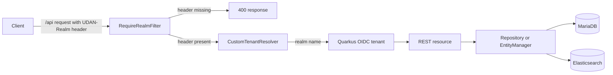

# Architecture overview

Written from this repository's code only. Dependencies outside the repository are described, not documented.

## Components

One Gradle module (`settings.gradle`, `rootProject.name = 'index'`), one Quarkus application, Java package
`com.nistapp.uda.index` under `src/main/java/`.

| Component | Where | Role |
|---|---|---|
| REST resources | `Domain.java`, `User.java`, `services/`, `users/` | JAX-RS endpoints (14 classes with `@Path`) |
| Filters and tenant | `config/` | Realm check, tenant resolver, security headers, XSS sanitising, error mappers |
| Entities | `models/` | JPA and Hibernate Search entities |
| Repositories | `repository/` | DAO classes (see [ADR 0003](../adr/0003-database-access-through-repositories.md)) |
| Search | `search/` | Elasticsearch analysis, index layout, startup reindex |
| Utilities | `utils/` | Input sanitiser, logger helper, sequence status |

## Entry points

- `src/main/java/com/nistapp/uda/index/RestApplication.java`: `@ApplicationPath("/api")`; there is no `@QuarkusMain`.
- REST roots under `/api`: `/domain`, `/search`, `/searchTerms`, `/sequence`, `/clickevents`, `/votes`, `/status`,
  `/user`, `/users`, `/admin`.
- `src/main/resources/application.properties`: configuration. Local secrets come from an untracked
  `local-secrets.properties` (see the root [README.md](../../README.md)).
- `src/main/resources/db/migration/`: Flyway migrations, `V1.0.0` to `V1.0.9` ([ADR 0001](../adr/0001-flyway-for-schema-migrations.md)).
- `start-server.sh` and `pre-flight-check.sh`: local start with environment checks.

## Data stores and external services

- MariaDB through JDBC, schema by Flyway.
- Elasticsearch through Hibernate Search (`quarkus.hibernate-search-orm.*` in `application.properties`).
- Keycloak as OIDC provider; the sibling infrastructure project that runs these services locally is an external
  dependency and is not documented here.

## Tenant and authentication flow

The filter runs after CORS and before authentication ([ADR 0002](../adr/0002-tenant-from-udan-realm-header.md)).

## Repository notes

Census of tracked files (`git ls-files`) on `dev` at `30007cb`; nothing was moved.

| Category | Count | Paths | Tag |
|---|---|---|---|
| Files over 512 KB | 0 | none | n/a |
| Binary files | 1 | `gradle/wrapper/gradle-wrapper.jar` | by design (Gradle wrapper) |
| Minified assets | 0 | none | n/a |
| Catch-all directories | 1 | `src/main/java/com/nistapp/uda/index/utils/` (3 main files, 1 test) | by design (small) |

The earlier audit counted an oversized keystore under `config/`; it is no longer tracked.
