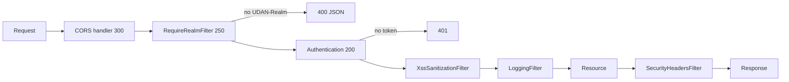

# Request filters and security headers

Two filters are off in the `dev` profile: `SecurityHeadersFilter` and `XssSanitizationFilter`. Both run in every
other profile (`test`, `prod`). Do not assume a header seen in production also appears on a local `dev` run.
This is an explanation and reference page.

## Order of a request

The diagram shows the order from the code comments and annotations. The Quarkus handler priorities (300, 250, 200)
come from `config/RequireRealmFilter.java`.

The `400` and `401` answers come from Quarkus HTTP handlers, before the JAX-RS filters. They carry no security
headers. The `401` part follows from the handler order, and no test checks the headers on it.

## Filters

| Filter | File | Runs | Profiles |
|---|---|---|---|
| `RequireRealmFilter` | `config/RequireRealmFilter.java` | Quarkus HTTP handler, priority 250 | All. Off only when `udan.realm.required=false` (set for `%test`) |
| `XssSanitizationFilter` | `config/XssSanitizationFilter.java` | JAX-RS request filter, `@PreMatching` | `@IfBuildProfile("!dev")`: off in `dev` |
| `LoggingFilter` | `config/LoggingFilter.java` | JAX-RS request and response | All. Puts `X-Correlation-ID` (or a new UUID) in the log context |
| `SecurityHeadersFilter` | `config/SecurityHeadersFilter.java` | JAX-RS response filter | `@UnlessBuildProfile("dev")`: off in `dev` |

`XssSanitizationFilter` cleans every query parameter and the JSON body of `POST`, `PUT` and `PATCH`. The body limit
is `udan.sanitizer.max-body-size` (default `5M`); above it the answer is `413`.

## Headers added by `SecurityHeadersFilter`

The filter adds these seven headers to every JAX-RS response outside the `dev` profile
(`SecurityHeadersFilterTest` checks them):

| Header | Value |
|---|---|
| `X-Content-Type-Options` | `nosniff` |
| `X-Frame-Options` | `DENY` |
| `X-XSS-Protection` | `1; mode=block` |
| `Strict-Transport-Security` | `max-age=31536000; includeSubDomains` |
| `Content-Security-Policy` | `default-src 'self'` |
| `Referrer-Policy` | `strict-origin-when-cross-origin` |
| `Permissions-Policy` | `camera=(), microphone=(), geolocation=()` |

The filter uses `add`, not `set`. A reverse proxy that adds the same header gives a response with two values.

## Why CONVENTIONS.md changed

[CONVENTIONS.md, section 11](../CONVENTIONS.md#11-input-safety) said both filters "apply to every request". The code
disagrees: both are off in the `dev` profile, and the security headers apply to responses that pass through JAX-RS.
The section now says so and links here.
