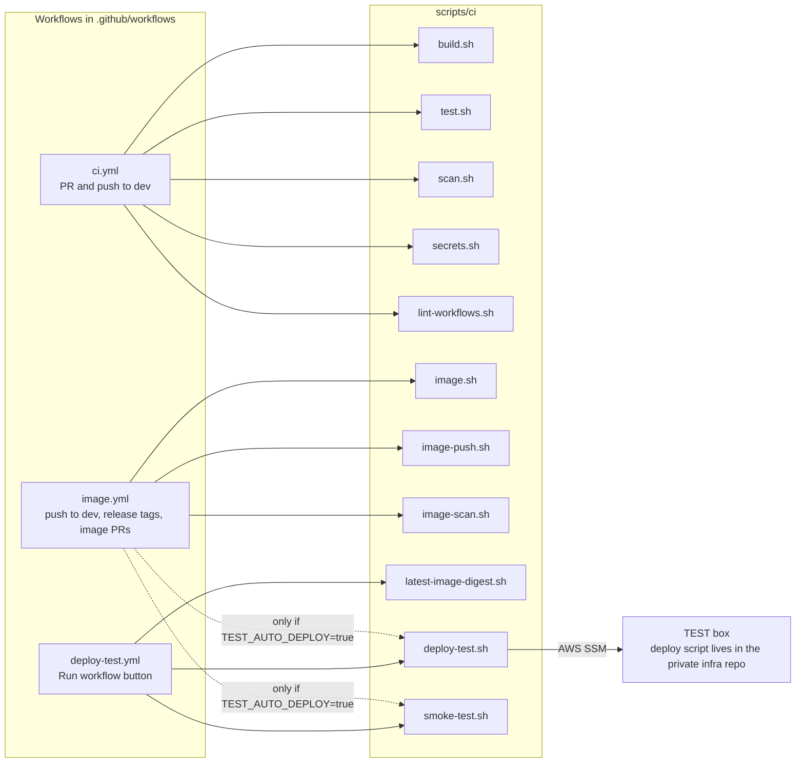

# CI scripts

Small scripts that build, test, scan and package the Server. The GitHub workflows only call these scripts, so you can run the same steps on your laptop.

Run them from anywhere. They move to the repo root themselves. You need Java 21 (`JAVA_HOME` must point to it).

Which workflow calls which script:

| Script | What it does |
|---|---|
| `build.sh` | Builds the jar. Skips tests. |
| `test.sh` | Runs the tests (Java 21). Needs MariaDB and Elasticsearch on `127.0.0.1` (start the local stack first). In `ci.yml` the step is non-blocking (`continue-on-error`): 7 `SecurityHeadersFilterTest` cases fail (the expected security response headers, such as `X-Content-Type-Options`, `Content-Security-Policy` and `Permissions-Policy`, are missing from the test responses). The rest pass. CI points the JDBC URL at its own MariaDB without SSL through `QUARKUS_DATASOURCE_JDBC_URL`, because the packaged URL asks for SSL. Fix the 7 failures, then make the step blocking again. |
| `scan.sh` | Does nothing for now and prints that the scan is skipped. The NVD-based scan is not used. |
| `image.sh` | Builds the Docker image `udan-server:local`. Does not push. Change the name with `IMAGE_NAME` and `IMAGE_TAG`. With `IMAGE_TAR` set it writes the image to a tar file instead (used by CI). |
| `image-scan.sh` | Scans an image tar with Trivy (run from a pinned container) and writes a CycloneDX SBOM. Fails on fixable HIGH/CRITICAL findings. Needs Docker. |
| `image-push.sh` | Loads an image tar and pushes it under the tags you give. Needs a prior `docker login`. Refuses `latest`. Used by `image.yml` only. |
| `secrets.sh` | Scans a commit range for secrets with a pinned gitleaks (`ci.yml`, job `Secret Scan`). Old history is not scanned. |
| `lint-workflows.sh` | Lints the workflows with pinned actionlint and zizmor (`ci.yml`, job `Workflow Lint`). |
| `deploy-test.sh` | Sends one image digest to the TEST box through AWS SSM (OIDC login, one fixed SSM document that validates its inputs) and waits for the result. The target instance comes from the variable `INSTANCE_ID` and the region from `AWS_REGION`; do not write real values in this repo. Runs only in the `test` environment of GitHub Actions; checks its inputs before any AWS call. |
| `smoke-test.sh` | Post-deploy sanity check from outside: public search answers JSON (nginx, Server, Elasticsearch), protected endpoint refuses no token and a malformed token (401). No secrets, read-only. Runs as job `Sanity check TEST` after every TEST deploy, with the repo variable `TEST_BASE_URL`. Laptop: `scripts/ci/smoke-test.sh https://<test host>`. |
| `latest-image-digest.sh` | Prints the digest pushed by the newest `image.yml` push run on `dev` (artifact `image-digest`). Waits for that run's `Build and Push` job only, not the scan; fails if the job failed, never falls back to an older image. Used by `deploy-test.yml` when no digest is given. Needs `gh` and `GITHUB_REPOSITORY`; works on a laptop too. |

## Deploying to TEST
A push to `dev` builds and pushes the image but does not deploy it. TEST changes only when someone runs the `Deploy to TEST` workflow (`deploy-test.yml`): `gh workflow run deploy-test.yml` deploys the newest `dev` image, `-f digest=sha256:<64 hex>` deploys a given one (redeploy or rollback). Setting the repository variable `TEST_AUTO_DEPLOY` to `true` turns the deploy after every push back on.

No script contains a secret. Never put one in these files.
